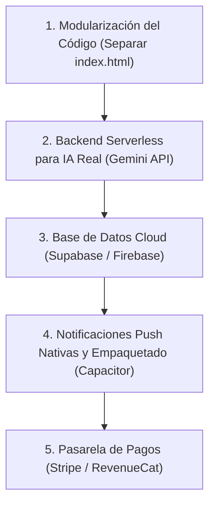

# Barney — Dossier Técnico y de Traspaso para Desarrolladores

> **Versión del Proyecto:** `v1.0.1-demo` (Build 19)  
> **Fecha de Documentación:** Octubre 2026  
> **Estado:** 100% Operativa en producción (PWA / GitHub Pages) · Modo Demo Abierto · 1.000/1.000 Tests aprobados.

---

## 1. Resumen Ejecutivo y URLs de Producción

| Concepto | Detalle |
|---|---|
| **Aplicación en Producción (Live PWA)** | **https://mask630.github.io/barney-app/** |
| **Repositorio GitHub** | **https://github.com/mask630/barney-app** |
| **Rama principal** | `main` |
| **Hosting & CDN** | GitHub Pages (HTTPS forzado, HTTP/2, compresión gzip) |
| **Estrategia PWA** | Standalone instalable en Android (Chrome) e iOS (Safari), offline-first mediante `sw.js` (Network-First para navegación, Cache-First para estáticos). |
| **Directorio local de trabajo** | `c:\Users\telem\Documents\antigravity\magical-davinci` |

---

## 2. Concepto del Producto, Propósito y Audiencia

### 2.1 Qué es Barney
**Barney** es un copiloto de bolsillo inteligente, discreto y altamente especializado para hombres en relaciones (desde la fase *crush* o primeras citas hasta relaciones estables o matrimonio). Inspirado en el ingenio metódico de Barney Stinson (*Cómo conocí a vuestra madre*), actúa como un *wingman* personal que elimina la carga mental y evita los fallos típicos de memoria en la pareja.

### 2.2 Problemas clave que resuelve
1. **La «memoria de los detalles»:** Tallas de anillo, calzado, vestido, perfume exacto, marcas favoritas, tipo de café, alergias o comidas que detesta.
2. **El bloqueo comunicativo:** Generación instantánea de mensajes románticos, divertidos o de apoyo que no suenan a robot de IA, adaptados a la fase de la pareja y al momento del día.
3. **El radar de planes y regalos:** Detección de regalos por fotos o escaparates, y vigilancia de conciertos o espectáculos en la ciudad del usuario.
4. **La gestión de la convivencia y el estado biológico:** Estimación orientativa del ciclo ovulatorio/menstrual y alertas sutiles de aniversarios, santos y fechas clave (incluyendo el cumpleaños de la suegra).
5. **La gestión de crisis:** Un consultorio SOS de psicología de pareja con guiones precisos de qué decir y qué evitar ante discusiones o días difíciles.

### 2.3 Audiencia y Modelo de Negocio Futuro
- **Fase Actual (Demo Abierta):** Todas las características avanzadas están abiertas al 100% sin pasarelas de pago para facilitar el testeo masivo en teléfonos reales por parte de amigos y testers.
- **Fase Futura (Freemium PRO):** La arquitectura ya incluye el switch centralizado `FEATURES` y la función `hasAccess()`. En producción comercial, las funciones avanzadas (lectura en frío, agente Stifmeister, radar de conciertos, escáner de fotos IA) se bloquearán bajo suscripción (estimada en 4,99 €/mes o 29,99 €/año).

---

## 3. Credenciales, Cuentas y Entorno

> [!IMPORTANT]
> El programador entrante debe preservar intactos los demás proyectos existentes en la cuenta (`alros-inmobiliaria`, `lipedema-malaga-web`, etc.). Solo debe interactuar con el repositorio `barney-app`.

| Servicio / Entorno | Usuario / Identificador | Ubicación de Credenciales |
|---|---|---|
| **GitHub** | `mask630` | Autenticado en Windows Credential Manager (`LegacyGeneric:target=git:https://github.com`). Personal Access Token configurado con ámbito `repo`. |
| **Git Local Author** | `Isaac Alros <isaac.alros@gmail.com>` | Configurado en Git global (`git config user.name / user.email`). |
| **Supabase (Recomendado para Telemetría Cloud)** | Cuenta `mask630` (OAuth GitHub) | Para conectar la base de datos de sugerencias, basta iniciar sesión en [supabase.com](https://supabase.com) con la cuenta de GitHub `mask630` y generar el proyecto `barney-app`. |
| **PIN de Bloqueo de la App (Seguridad de Usuario)** | Configurable por el usuario | Hash SHA-256 con sal criptográfica aleatoria guardado en el `localStorage` del dispositivo (`barney_v9`). No se transmite a ningún servidor. |

---

## 4. Arquitectura de Software y Ficheros del Proyecto

El proyecto sigue una arquitectura **Single Page Application (SPA) pura y sin dependencias externas en tiempo de ejecución**, optimizada para cargar en menos de 200 ms y funcionar 100% offline.

```
c:\Users\telem\Documents\antigravity\magical-davinci\
├── index.html                 # App completa: UI, lógica, estado, agentes IA, tests integrados (174 KB)
├── tailwind.min.css           # Tailwind CSS v3 compilado localmente (19.5 KB, cero CDN externo)
├── sw.js                      # Service Worker PWA (barney-pwa-v2, Network-First para HTML)
├── manifest.json              # Web App Manifest PWA (dark theme, standalone, iconos)
├── version.json               # Versión de compilación y hash de cache
├── icon.svg                   # Icono vectorial maestro de Barney
├── icon-192.png               # Icono PWA rasterizado 192x192
├── icon-512.png               # Icono PWA rasterizado 512x512
├── icon-maskable-192.png      # Icono adaptativo Android 192x192
├── icon-maskable-512.png      # Icono adaptativo Android 512x512
├── netlify.toml               # Cabeceras de seguridad y MIME types (por si se aloja en Netlify)
├── tailwind.config.js         # Configuración y safelist de gradientes y clases dinámicas
├── input.css                  # Directivas base de Tailwind
├── .gitignore                 # Reglas de exclusión de ficheros temporales y logs
└── archive/                   # Ficheros históricos desfasados preservados
    ├── app.js
    └── styles.css
```

### 4.1 Puntos Clave de la Implementación en `index.html`

1. **Estado Central Reactivo (`S`):**
   - Objeto singleton `S` que almacena: array `girls` (perfiles), `cur` (índice activo), `tab` (`hoy`, `ella`, `ideas`, `ajustes`), `theme` (`dark`/`light`), `persona` (`barney`, `direct`, `stifmeister`), `pin` (`{hash, salt}`), `city` (coordenadas para cálculo solar y conciertos), y `analytics` (telemetría local).
   - Persistencia local mediante `save()` con captura y notificación ante fallos de cuota (`QuotaExceededError`).
2. **Motor Astronómico Solar y Lunar Real:**
   - Implementación matemática de ecuaciones NOAA (`calcRealSunTimes`) que calcula amanecer, hora dorada y atardecer exacto por latitud/longitud con compensación de huso horario y horario de verano/invierno (DST).
   - Cálculo de fase lunar (`moon()`) para generar pretextos de planes nocturnos o paseos.
3. **Motor Biológico de Pareja:**
   - Algoritmo de calendario (`dday`, `phase`) con estados: `mens` (menstruación), `fert` (ventana fértil), `pms` (síndrome premenstrual) y `ok` (fase óptima), con margen configurable de ±3 días y descargo legal/médico explícito.
4. **Sistema de Tres Agentes IA:**
   - `PERSONAS.barney`: Tono carismático, estratega, pícaro pero educado.
   - `PERSONAS.direct`: Ejecutivo de alta gama, conciso, elegante y resolutivo.
   - `PERSONAS.stifmeister`: Humor desenfadado, fiestero y atrevido.
5. **Captura Inteligente («+ Apuntar»):**
   - Función `parseSmartCapture(raw)` que analiza texto libre o etiquetas mediante patrones RegEx y clasifica automáticamente hacia `sizes` (tallas de anillo, calzado, ropa), `favs` (perfumes, cafés, dulces), `more` (suegra, le molesta, joyas), `events` (artistas/conciertos con ciudad detectada), `wish` (regalos con marcas detectadas) o `notes` (recordatorios de conversación con cadencia de 3 días).
6. **Seguridad Criptográfica del PIN:**
   - Implementación nativa de SHA-256 (`sha256`) combinada con sal pseudoaleatoria (`sha256WithSalt`) para bloquear la interfaz ante miradas indiscretas sin enviar nada a la red.
7. **Batería de Pruebas Unitarias Integrada:**
   - Función `runInApp500Tests()`: 500 pruebas de perfiles, fases, capturas, sol y santos.
   - Función `runInApp500ProTests()`: 500 pruebas de lectura en frío, mensajes de los 3 agentes, conciertos y SOS.
   - Ambas ejecutables desde el navegador o mediante script Node.js (`test_1000.js`).

---

## 5. Privacidad, RGPD y Consideraciones Legales

Barney fue diseñado bajo una estricta filosofía **Zero-Cloud por defecto**:
- **RGPD Art. 2.2.c:** El tratamiento de datos de terceras personas (cumpleaños, gustos, talla de ropa, ciclo orientativo) está exento del régimen de responsable/encargado del RGPD al tratarse de un ejercicio exclusivamente personal o doméstico dentro del teléfono del usuario.
- **Sin Scraping:** No se realizan peticiones a APIs privadas de Instagram ni TikTok; la deducción de estilo es heurística y basada en arquetipos psicológicos (`SOCIAL_ARCHETYPES`).
- **Descargo de Responsabilidad Médico:** La estimación biológica incluye advertencia destacada en pantalla indicando que es un cálculo matemático orientativo y nunca un método diagnóstico ni anticonceptivo.
- **Derecho al Olvido Instantáneo:** Botón «Borrar todo» en *Yo → Privacidad* que destruye el almacenamiento local en un clic.

---

## 6. Guía de Traspaso para el Programador Entrante

Si un nuevo desarrollador o equipo toma el proyecto para llevarlo al siguiente nivel comercial, esta es la hoja de ruta técnica recomendada en orden de prioridad:



### Paso 1: Modularización del Código Fuente
- **Objetivo:** Dividir `index.html` (actualmente de ~2.900 líneas) en una estructura limpia de módulos ES6 o migrarlo a Vite + React/Svelte/Vue manteniendo las mismas clases Tailwind.
- **Estructura sugerida:**
  - `src/core/state.js`: Estado `S`, `save()`, persistencia.
  - `src/core/astro.js`: Algoritmo solar NOAA y lunar.
  - `src/core/cycle.js`: Cálculo de fase biológica.
  - `src/ai/personas.js`: Voces de Barney, Ejecutivo y Stifmeister.
  - `src/ai/capture.js`: Clasificador esquematizado `parseSmartCapture`.
  - `src/ui/`: Vistas `hoy.js`, `ella.js`, `ideas.js`, `yo.js`, `sheets.js`.
  - `src/crypto/pin.js`: Algoritmo SHA-256 y bloqueo.

### Paso 2: Conectar IA Real con Google Gemini API
- **Problema actual:** Los mensajes IA y el escáner de fotos funcionan mediante plantillas heurísticas avanzadas para no requerir servidor.
- **Implementación técnica recomendada:**
  - Crear un endpoint ligero en Cloudflare Workers o Supabase Edge Functions: `POST /api/ai/generate-messages`.
  - Recibir: `{ persona, goal, stage, partnerName, likes, dislikes }`.
  - Llamar al SDK oficial `@google/genai` con modelo `gemini-1.5-flash` o `gemini-2.0-flash`.
  - Prompt del sistema: *"Eres Barney Stinson actuando como copiloto de pareja. Genera 3 frases cortas, ingeniosas y naturales en español de España para enviar por WhatsApp..."*.
  - En el cliente: Si hay internet y respuesta del endpoint, mostrar el texto generado; si falla o no hay conexión, recurrir a las plantillas locales como *fallback* garantizado.

### Paso 3: Telemetría y Buzón de Sugerencias en Cloud (Supabase)
- **Problema actual:** Los reportes de testers se guardan en el `localStorage` de cada móvil.
- **Implementación técnica recomendada:**
  1. Crear un proyecto en [Supabase](https://supabase.com).
  2. Ejecutar la migración SQL:
     ```sql
     create table tester_reports (
       id bigint generated always as identity primary key,
       created_at timestamptz default now(),
       tester_name text,
       suggestion text,
       analytics jsonb,
       device text
     );
     alter table tester_reports enable row level security;
     create policy "Permitir inserts anonimos" on tester_reports for insert with check (true);
     ```
  3. En la app, sustituir el botón de sugerencias por una llamada `fetch('https://<project-ref>.supabase.co/rest/v1/tester_reports', ...)` con la cabecera `apikey: SUPABASE_ANON_KEY`.

### Paso 4: Empaquetar como App Nativa iOS y Android (Capacitor)
- **Objetivo:** Poder publicar la app en Google Play Store y Apple App Store con notificaciones push en segundo plano.
- **Pasos técnicos:**
  ```bash
  npm init @capacitor/app
  npm install @capacitor/core @capacitor/cli @capacitor/android @capacitor/ios @capacitor/push-notifications @capacitor/haptics
  npx cap add android
  npx cap add ios
  npx cap copy
  ```
  - Configurar las notificaciones push nativas mediante Firebase Cloud Messaging (FCM) y Apple APNs.

### Paso 5: Monetización y Pasarela de Pago
- Cuando se decida cerrar la fase Demo:
  - Usar **RevenueCat** (en app nativa Capacitor) o **Stripe Customer Portal** (en web PWA).
  - Configurar el interruptor en `FEATURES`:
    ```javascript
    function hasAccess(featureKey) {
      if (S.tier === 'pro') return true;
      return FREE_TIER_FEATURES.includes(featureKey);
    }
    ```

---

## 7. Instrucciones para Ejecutar y Testear Localmente

1. **Clonar el repositorio:**
   ```bash
   git clone https://github.com/mask630/barney-app.git
   cd barney-app
   ```
2. **Servir localmente para pruebas:**
   ```bash
   # Opción Node
   npx serve -l 3000
   # Opción Python
   python -m http.server 3000
   ```
3. **Ejecutar la suite de 1.000 tests automatizados:**
   - La suite está embebida en el propio código y en los scripts auxiliares de testeo. Se ejecuta abriendo el panel de desarrollador en el navegador (`runInApp500Tests()`, `runInApp500ProTests()`) o mediante Node.js:
   ```bash
   node scratch/test_1000.js
   ```
4. **Verificación de Auditoría de Vistas:**
   - Comprobación de las 232 pantallas y estados sin excepciones ni roturas:
   ```bash
   node scratch/audit.js
   ```

---
*Fin del documento de traspaso técnico.*
